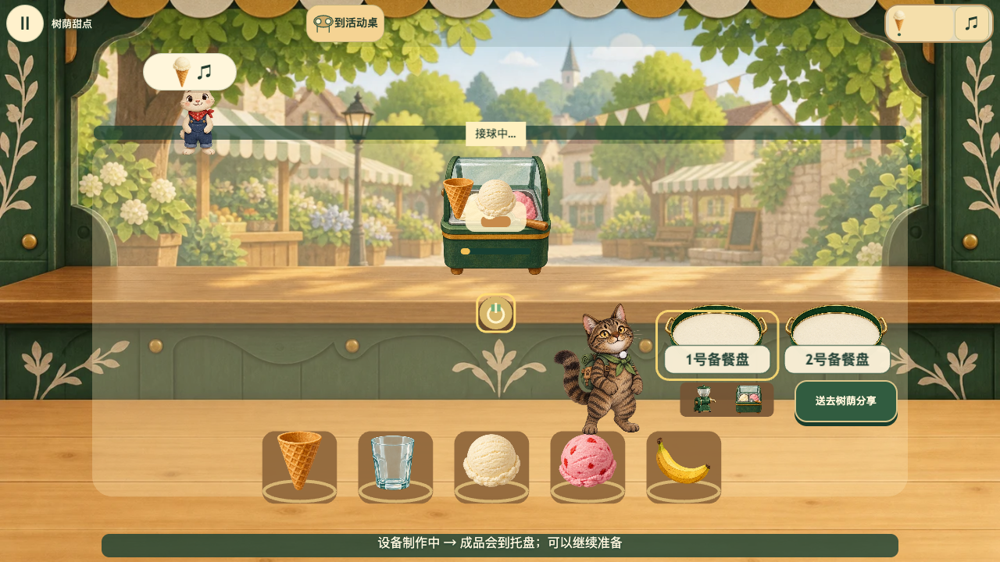
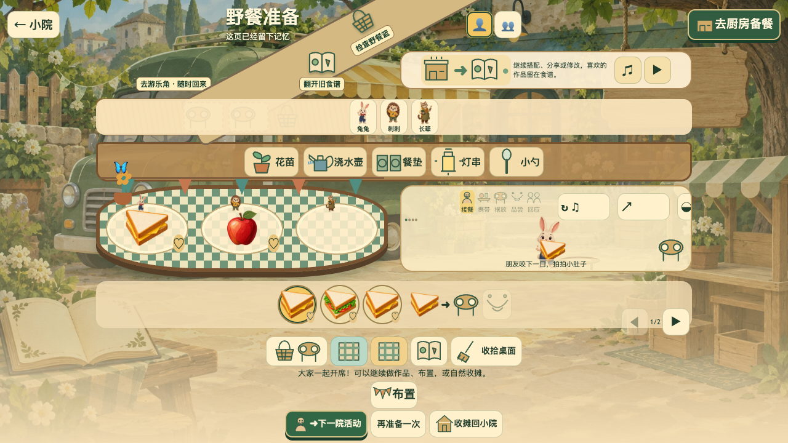
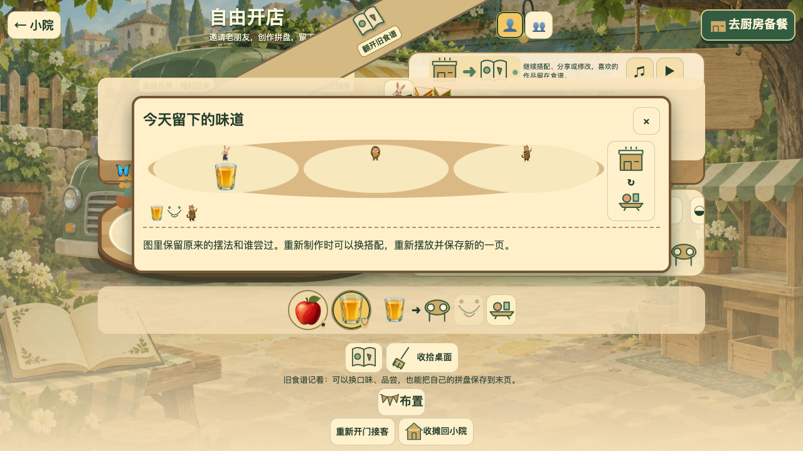

# 《大咪的英语餐车》设计说明

雪梨教育AI游戏开发大赛｜2026年10月12日

说明对象：五章活动与自由厨房整合版，内容版本 `adventure-experience-2`。受测版本与制作来源见[证据附录](evidence.md)。

## 一辆餐车，一院好朋友

《大咪的英语餐车》是一款面向3–6岁儿童的单人英语网页游戏：和狸花猫大咪一起听朋友的需要、制作食物，把一顿饭变成小院里的共同活动。温暖的纸艺场景连接早餐、甜点、野餐、晚餐和社区小食会。玩家既是小主厨，也是邀请朋友、布置餐桌的人；英语服务于“我想为谁做什么”，游戏留下的是食物、关系与自己的作品。

## 从听需要，到一起开席

以第三章“野餐准备”为例：兔兔说“A cheese sandwich, please.”，刺刺需要生菜番茄三明治。玩家选择先接待谁，在厨房把两片面包和对应馅料放上组合板，盖合制作；成品到盘后，点餐盘标签拿起整盘，再点朋友明确交付。气泡可单独重听，听声音不会替玩家送餐。

手机和Pad采用点选物件、再点目标的操作方式；拖动是可选操作。两只餐盘各有三格，玩家可选择先完成一份，或在加工期间准备另一份。明确订单要求食物和数量相符，盘中顺序不限；开放委托给出有限可选方案，例如树荫分享可选不同冰淇淋杯；自由创作则允许合法搭配，没有一份指定答案。错单保留整盘，可以放下、调整或重新制作，触控落空与设备忙不会被算成英语错误。

野餐由谁先实际收到食物决定路线：兔兔先收到，就检查篮子，再做三明治和水果打包；刺刺先收到，就取出餐垫，把两份已交付食品分别摆到席位。两路最后铺桌布、分享并留下同一野餐食谱页。活动后还能继续创作或回访，主动收摊回院是自然结束点。

图1｜容器与口味进入设备，启动后加工，成品才到餐盘；玩家可以继续准备。真实运行截图。

## 英语变成可做的事情

新词先与图片、声音和动作相遇，再进入需要听懂的请求：cheese对应看得见的馅料，two对应要准备的份数，put、in、on对应物件与位置。图示、食谱示范、重听和撤回支持慢想与试错。十类可选小游戏延伸听音、配对、数量、寻物、布置和动作体验；拼写与组句不挡住故事。

游戏分别记录示范、帮助、尝试和回访，操作成功不等于英语掌握，看过答案也不会变成独立听懂。目前尚无儿童学习效果或独立理解的验证结论。

## 三处有可见后果的乐趣

- **选择改变做法。** 野餐两路需要不同的打包或分餐动作；晚一点服务另一位朋友不会受罚，重玩可以尝试另一种安排。
- **做出的食品进入生活。** 早餐后找到花苗并浇水，甜点可以比较和品尝，晚餐让朋友搬杯、带灯；花、彩旗、桌布和灯伴随真实行动改变小院。
- **作品留下自己的安排。** 自由厨房可停止接客后继续制作，改位置、分享、品尝并保存；旧食谱保留组成、摆法和谁尝过，熟客回访也承接过去的活动。

图2｜兔兔路线中实际打包的三明治和苹果已经摆上餐桌，铺布、开席后朋友品尝；选择变成场景里的结果。

## AI怎样参与制作

OpenAI Codex参与规则、交互、保存、原创图示及验证代码；内置imagegen制作背景、角色姿态和独立食品，再由代码接入游戏。一个实际修订是：初稿三明治、汉堡多出了配料，会误导孩子对食物的理解。检查后按真实配方约束重新生成——芝士三明治只含面包与芝士，普通汉堡不带芝士——再裁切、核对透明边和资源映射，最终用于厨房成品和活动餐桌。制作摘要与保存的原始提示词在附录中分别标明。

AI用于开发期。游戏运行时由明确规则判断订单，随机只选择合法内容；Samantha、Tingting提供普通开发TTS，均未完成听审，不包装为大模型教学或实时对话。

图3｜“今天留下的味道”保留果汁原来的位置与品尝者，可以回看并重新制作；保存记忆不会复制可供应食品。

## 当前版本与评审体验

五章、双野餐路线、自由作品及小游戏已实现；2026年10月12日收尾的同版报告走通了代表性辅助浏览器路径。仍有演出按钮裁切、暂停后键盘焦点越界等问题，工程检查未全部通过。手机触控已有模拟记录；同版实体手机、Pad专项复核、儿童观察、教研与人工听审尚未完成，素材及声音分发权待核验，不能据此宣布发布审核通过。

评审时由提交者启动本地浏览器预览，从小院“正在准备”进入晨光活动，做早餐、种花；连续进入野餐，先交给兔兔体验打包，完成后正常重玩并先给刺刺体验分餐；再进入自由开店，停止接客后做作品、摆放、品尝、保存和收摊。全程使用可见入口。

当前尚缺与本说明同版的已核实在线Demo；[历史站点](https://tabby-english-food-truck.yuan576264675.chatgpt.site/)仍为 `m2.2`，不能代替上述作品。本说明及真实配图已形成正式材料，Demo交付和本次提交时效仍需补核。
